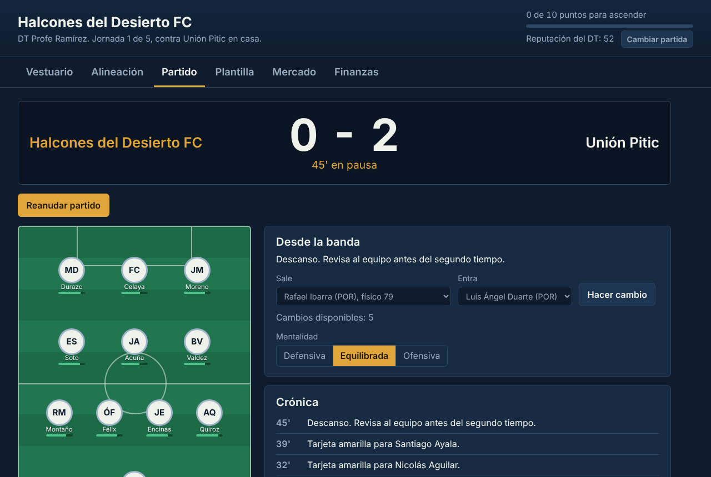
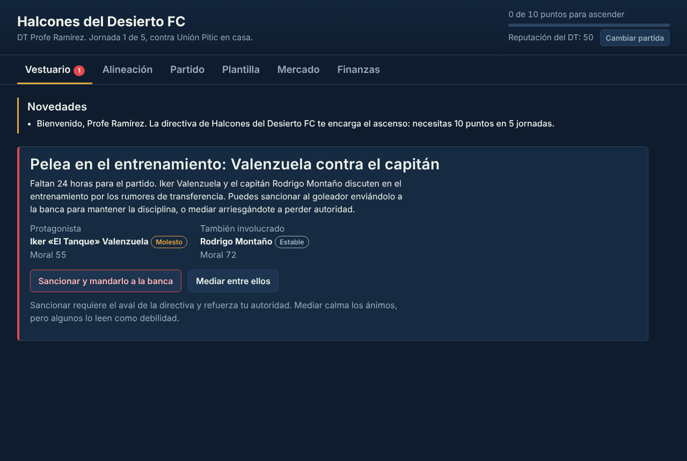
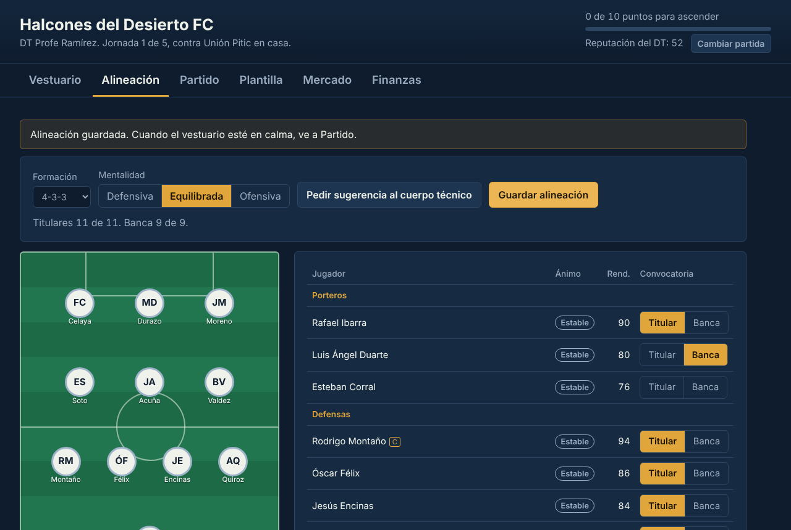
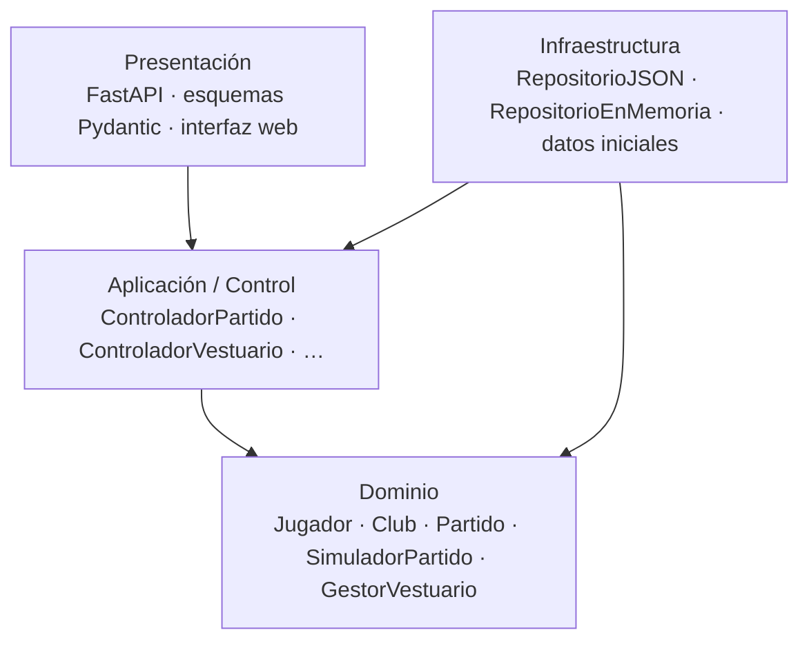

# Pro Manager Studio

**Simulador de Dirección Técnica de Fútbol** — aplicación web en Python y FastAPI.

Asumes el banquillo de los **Halcones del Desierto FC** (Hermosillo, Sonora) con una
misión: conseguir el ascenso en cinco jornadas. Para lograrlo tienes que armar el once,
leer el partido en tiempo real, resolver las crisis del vestuario y cuidar las finanzas
del club. El proyecto implementa el módulo *Núcleo de Gestión, Motor de Partidos y
Sistema de Vestuario* descrito en la [especificación original](docs/especificacion_original.pdf).



[](https://github.com/Poyopoyo88/Pro-Manager-Studio/actions/workflows/ci.yml)

---

## Contenido

- [Qué puedes hacer](#qué-puedes-hacer)
- [Instalación y ejecución](#instalación-y-ejecución)
- [Arquitectura en 4 capas](#arquitectura-en-4-capas)
- [Reglas de negocio implementadas](#reglas-de-negocio-implementadas)
- [Pruebas y Quality Gate](#pruebas-y-quality-gate)
- [Estructura del repositorio](#estructura-del-repositorio)
- [Documentación](#documentación)
- [Despliegue en Render](#despliegue-en-render)
- [Estado del backlog](#estado-del-backlog)
- [Licencia y datos](#licencia-y-datos)

## Qué puedes hacer

| Historia | Funcionalidad |
|---|---|
| **HU-01** Configuración táctica y alineación | Elegir formación (4-4-2, 4-3-3, 4-2-3-1, 3-5-2, 5-3-2) y mentalidad, pedir una sugerencia al cuerpo técnico y validar el once (11 titulares, 1 portero, hasta 9 suplentes). |
| **HU-04** Conflictos de vestuario | Resolver crisis sancionando (con aval de la directiva) o dialogando. Cada jugador tiene personalidad, moral, estado de ánimo e historia propia. |
| **HU-05** Decisiones en tiempo real | Simulación minuto a minuto con goles, tarjetas, lesiones y fatiga. El partido se detiene en el descanso y ante incidencias críticas para que hagas cambios y ajustes la mentalidad. |
| **HU-06** Finanzas | Presupuesto de fichajes, masa salarial contra su límite, ingresos por taquilla y premios. |
| **HU-03** Fichajes | Ofertar por jugadores del mercado; el representante acepta, contraoferta o rechaza. |
| **HU-02** Ojeadores | Informes con un rango estimado de calidad; mejor reputación del club, informes más precisos. |

La partida abre con el escenario crítico de la especificación: a 24 horas del partido, el
goleador estrella discute con el capitán por rumores de transferencia.

| Crisis de vestuario | Alineación con estado de ánimo en la cancha |
|---|---|
|  |  |

## Instalación y ejecución

Requisitos: **Python 3.11 o superior** y Git.

```bash
git clone https://github.com/Poyopoyo88/Pro-Manager-Studio.git
cd Pro-Manager-Studio

python -m venv .venv
# Windows:      .venv\Scripts\activate
# macOS/Linux:  source .venv/bin/activate

pip install -e ".[dev]"
uvicorn pro_manager.main:app --reload
```

Luego abre:

- **Juego:** <http://127.0.0.1:8000>
- **Documentación interactiva de la API (Swagger):** <http://127.0.0.1:8000/docs>
- **ReDoc:** <http://127.0.0.1:8000/redoc>

### Variables de entorno

| Variable | Valores | Por defecto | Uso |
|---|---|---|---|
| `PM_REPOSITORIO` | `json`, `memoria` | `json` | Dónde se guardan las partidas. |
| `PM_DIRECTORIO_PARTIDAS` | ruta | `partidas_guardadas` | Carpeta de las partidas en formato JSON. |
| `PORT` / `HOST` | número / IP | `8000` / `0.0.0.0` | Usadas por `python -m pro_manager` en producción. |

## Arquitectura en 4 capas



- El **dominio** solo usa la biblioteca estándar de Python: no conoce FastAPI, Pydantic ni
  la interfaz (restricción de la sección 4). Una prueba automatizada lo verifica en cada
  ejecución (`tests/unitarias/test_arquitectura.py`).
- La **aplicación** coordina casos de uso sin reglas de negocio y define los *puertos*
  (`RepositorioPartidas`, `ProveedorDatosIniciales`) que la infraestructura implementa.
- Detalle completo en [docs/04_arquitectura.md](docs/04_arquitectura.md).

## Reglas de negocio implementadas

| Regla | Dónde vive | Cómo se prueba |
|---|---|---|
| **RN-01** Atributos de jugador en `[1, 100]` | `dominio/atributos.py`, `dominio/jugador.py` | Particiones de equivalencia y valores límite (0, 1, 2, 50, 99, 100, 101). |
| **RN-02** Sin exceder presupuesto ni masa salarial | `dominio/club.py` | Límite exacto permitido; un peso de más, rechazado. |
| **RN-03** Un Rebelde necesita mediación o sanción para volver a Estable | `dominio/estado_animo.py` | Todos los eventos probados contra el estado Rebelde. |
| **CU-01 3a** Suplente inhabilitado | `dominio/partido.py` | Error `jugador_inhabilitado` (HTTP 422). |
| **CU-01 5a** Límite de 5 cambios | `dominio/partido.py` | Error `sustituciones_agotadas` (HTTP 422). |

Las reglas adicionales que surgieron al implementar (aval de la directiva, elogio por
jornada, crisis pendientes que bloquean el partido…) están en
[docs/01_vision_y_requisitos.md](docs/01_vision_y_requisitos.md#reglas-de-negocio).

## Pruebas y Quality Gate

```bash
pytest --cov          # 271 pruebas, cobertura mínima exigida: 80 %
ruff check .          # análisis estático
ruff format --check . # formato
```

Resultado actual: **271 pruebas aprobadas, 98.6 % de cobertura**. GitHub Actions ejecuta
el mismo Quality Gate en Python 3.11, 3.12 y 3.13 en cada *push* y *pull request*
(`.github/workflows/ci.yml`). Estrategia completa en
[docs/07_pruebas_y_calidad.md](docs/07_pruebas_y_calidad.md).

## Estructura del repositorio

```text
Pro-Manager-Studio/
├── .github/                    CI, plantillas de PR e issues, CODEOWNERS
├── docs/                       Documentación técnica en español (ver abajo)
├── src/pro_manager/
│   ├── dominio/                Capa de Dominio (sin dependencias externas)
│   ├── aplicacion/             Capa de Aplicación / Control
│   ├── infraestructura/        Capa de Infraestructura (+ datos/club_inicial.json)
│   ├── presentacion/           Capa de Presentación (api/ y web/)
│   └── main.py                 Punto de entrada ASGI
├── tests/
│   ├── unitarias/              Dominio, reglas de negocio y arquitectura
│   └── integracion/            Persistencia, controladores y API completa
├── pyproject.toml              Dependencias, pytest, cobertura y ruff
├── render.yaml                 Despliegue en Render
├── CONTRIBUTING.md             Flujo de ramas, TDD y revisión de código
└── CHANGELOG.md
```

La especificación proponía `src/Presentation`, `src/Application`, … Se conservaron las
cuatro capas con nombres en español y en minúsculas, como pide la guía de estilo de Python
(PEP 8) para paquetes.

## Documentación

| Documento | Contenido |
|---|---|
| [01 Visión y requisitos](docs/01_vision_y_requisitos.md) | Visión, proto-personas, escenario crítico, historias con criterios de aceptación, reglas de negocio. |
| [02 Caso de uso CU-01](docs/02_caso_de_uso_CU01.md) | Flujo principal, excepciones y su correspondencia con la API. |
| [03 Modelo de dominio y diseño](docs/03_modelo_de_dominio.md) | Modelo conceptual, GRASP, diagrama de clases de diseño y visibilidad. |
| [04 Arquitectura](docs/04_arquitectura.md) | Capas, dependencias, decisiones de diseño (DEC-01 a DEC-07). |
| [05 Diseño dinámico](docs/05_diseno_dinamico.md) | Secuencias, máquina de estados y modelo matemático de la simulación. |
| [06 API](docs/06_api.md) | Endpoints, formato de errores y ejemplos con `curl`. |
| [07 Pruebas y calidad](docs/07_pruebas_y_calidad.md) | TDD, particiones, valores límite, Quality Gate. |
| [08 Trazabilidad](docs/08_trazabilidad.md) | Problema → HU → CU → clases → endpoints → pruebas. |
| [09 Guía de juego](docs/09_guia_de_juego.md) | Cómo jugar una temporada. |
| [10 Licencias y datos](docs/10_licencias_y_datos.md) | Dependencias, licencias y tratamiento de datos. |

## Despliegue en Render

1. En Render elige **New → Blueprint** y conecta este repositorio; `render.yaml` define el
   servicio.
2. Render ejecuta `pip install .` y arranca con `python -m pro_manager`.
3. En el plan gratuito el disco es efímero: las partidas se pierden al redesplegar.

## Estado del backlog

| Prioridad | Historia | Estado |
|---|---|---|
| Alta | HU-01 Configuración táctica y alineación | Completa |
| Alta | HU-05 Decisiones tácticas en tiempo real | Completa |
| Alta | HU-04 Conflictos de vestuario | Completa |
| Media | HU-03 Negociación de fichajes | Completa (compra; venta pendiente) |
| Media | HU-02 Búsqueda de talento y cantera | Parcial: ojeadores listos, cantera pendiente |
| Media | HU-06 Administración financiera | Completa (ingresos, gastos, límites) |

Siguientes pasos sugeridos: cantera y promoción de juveniles, venta de jugadores, ruedas
de prensa y una tabla de liga completa.

## Licencia y datos

Proyecto académico. Antes de publicarlo con una licencia abierta, elige una (por ejemplo
MIT) y agrega el archivo `LICENSE`. Todos los clubes y jugadores son **ficticios**. La
aplicación solo guarda el nombre que escribes como DT y el estado de tu partida. Detalle en
[docs/10_licencias_y_datos.md](docs/10_licencias_y_datos.md).
