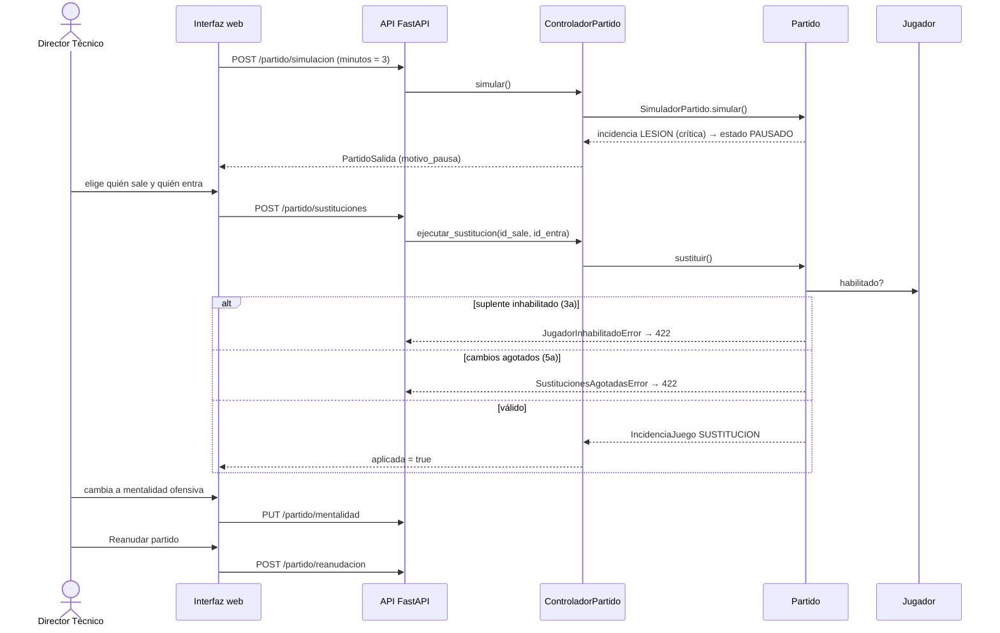

# 02 · Caso de uso CU-01

## Registrar cambios tácticos y gestión de crisis en partido

| Campo | Valor |
|---|---|
| Actor principal | Director Técnico (usuario) |
| Objetivo | Ajustar la estrategia e intervenir ante imprevistos (lesiones, bajas de moral, roces) durante un encuentro. |
| Precondición | La simulación de un partido oficial está activa (estado `EN_JUEGO` o `PAUSADO`). |
| Historias | HU-05 (principal), HU-04 (moral del vestuario durante el partido). |

## Flujo principal y su implementación

| Paso | Descripción | API | Código |
|---|---|---|---|
| 1 | El usuario pausa la simulación **o** el sistema se detiene por una incidencia crítica. | `POST /partido/pausa` · pausa automática en `POST /partido/simulacion` | `Partido.pausar()`, `SimuladorPartido._pausar_si_critica()` |
| 2 | El sistema muestra el panel con el estado de los jugadores y el marcador. | `GET /partido` | `mapeo.partido()` → `PartidoSalida` |
| 3 | El usuario elige un jugador lesionado o agotado y hace la sustitución. | `POST /partido/sustituciones` | `ControladorPartido.ejecutar_sustitucion()` |
| 4 | El usuario ajusta la mentalidad táctica desde la banda. | `PUT /partido/mentalidad` | `Partido.cambiar_mentalidad()` |
| 5 | El sistema valida las reglas de sustitución y aplica los cambios. | (dentro del paso 3) | `Partido.sustituir()` |
| 6 | El sistema confirma los ajustes y reanuda el encuentro. | `POST /partido/reanudacion` | `Partido.reanudar()` |

Todas las rutas cuelgan de `/api/v1/partidas/{partida_id}`.

### Incidencias críticas (paso 1 automático)

La simulación se detiene sola cuando, en el equipo del usuario:

- un jugador se **lesiona**;
- un jugador es **expulsado** (roja directa o doble amarilla).

Además se detiene en el **descanso** (minuto 45) para que el DT revise al equipo.

## Excepciones

| ID | Condición | Respuesta del sistema | HTTP | Código de error |
|---|---|---|---|---|
| **3a** | El suplente elegido está inhabilitado (lesionado, suspendido o con sanción interna). | Notifica el motivo y pide elegir otro suplente. La sustitución no se cuenta. | 422 | `jugador_inhabilitado` |
| **5a** | Ya se hicieron los 5 cambios permitidos. | Bloquea la sustitución adicional. | 422 | `sustituciones_agotadas` |
| — | El jugador que sale no está en el campo, o el que entra no está en la banca. | Rechaza la sustitución. | 422 | `sustitucion_invalida` |
| — | No hay partido en curso. | Rechaza la acción. | 409 | `partido_no_activo` / `sin_partido` |

## Diagrama de secuencia

## Pruebas que cubren el caso de uso

- `tests/integracion/test_api.py::test_cu01_flujo_principal`
- `tests/integracion/test_api.py::test_cu01_excepcion_3a_jugador_inhabilitado`
- `tests/integracion/test_api.py::test_cu01_excepcion_5a_limite_de_cambios`
- `tests/integracion/test_controladores.py::test_cu01_gestion_de_crisis_en_partido`
- `tests/unitarias/test_partido.py` (reglas del paso 5)
- `tests/unitarias/test_simulador.py::test_lesion_del_usuario_detiene_la_simulacion`
