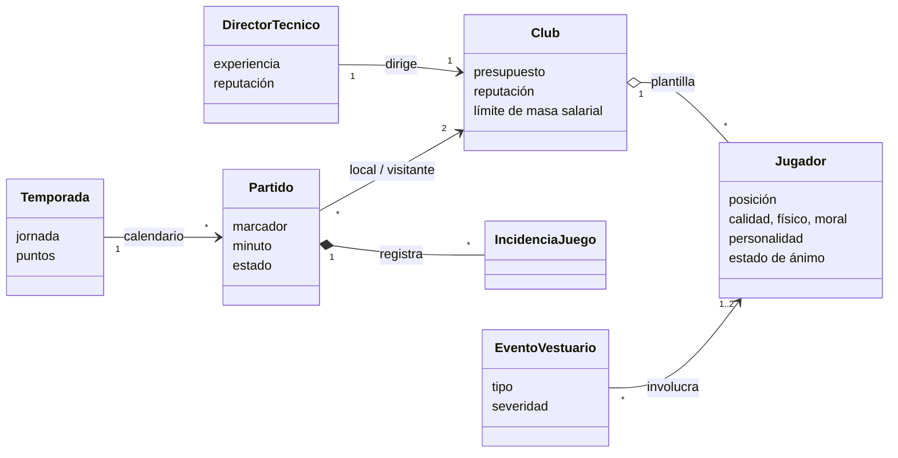
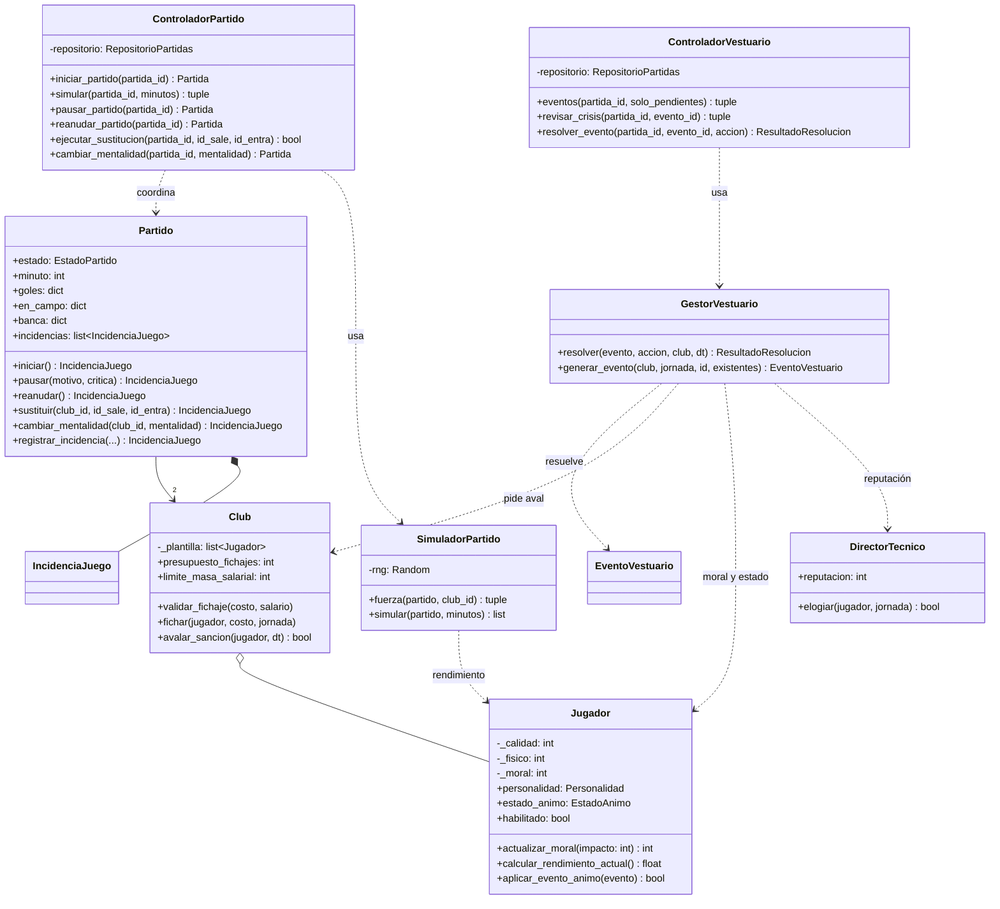

# 03 · Modelo de dominio y diseño orientado a objetos

Fuente: secciones 6, 7 y 8 de la especificación.

## Modelo conceptual



| Entidad | Responsabilidad |
|---|---|
| **Club** | Entidad institucional con presupuesto, reputación y plantilla. Aplica RN-02 y decide el aval a las sanciones. |
| **DirectorTecnico** | Avatar del usuario con experiencia y reputación. Administra su elogio por jornada. |
| **Jugador** | Integrante con posición, atributos, moral, personalidad, estado de ánimo e historia. |
| **Partido** | Enfrentamiento simulado: marcador, jugadores en campo y en banca, cambios e incidencias. |
| **EventoVestuario** | Acontecimiento interactivo que altera la moral (conflicto, rumor, queja, indisciplina). |
| **Temporada** | Calendario de rivales, puntos y objetivo de ascenso. |

## Patrones GRASP aplicados

| Patrón | Dónde | Justificación |
|---|---|---|
| **Information Expert** | `Jugador.calcular_rendimiento_actual()`, `Jugador.actualizar_moral()` | El jugador conoce su calidad, físico, moral, personalidad y estado de ánimo. |
| **Information Expert** | `Club.validar_fichaje()`, `Club.masa_salarial()` | El club conoce su presupuesto, su límite y los salarios de su plantilla. |
| **Creator** | `Partido.registrar_incidencia()` | El partido contiene y registra las `IncidenciaJuego`, así que las crea. |
| **Controller** | `ControladorPartido`, `ControladorVestuario` (y `ControladorPlantilla`, `ControladorClub`, `ControladorCarrera`) | Reciben las peticiones de la interfaz y las coordinan hacia el dominio. |
| **Low Coupling / High Cohesion** | `SimuladorPartido`, `GestorVestuario`, `Club` | Simulación, personalidades y finanzas están separadas; cada clase tiene un solo motivo de cambio. |
| **Pure Fabrication** | `SimuladorPartido`, `GestorVestuario`, `ProcesadorPostPartido`, `IAEntrenadorRival` | Servicios sin equivalente en el mundo real que mantienen cohesivas a las entidades. |
| **Protected Variations** | Puertos `RepositorioPartidas` y `ProveedorDatosIniciales` | Cambiar JSON por una base de datos no afecta a la aplicación ni al dominio. |
| **Polymorphism** | Jerarquía de `ErrorDominio` | La presentación traduce cada familia de errores a un código HTTP sin preguntar por tipos concretos. |

## Diagrama de clases de diseño (DCD)

Versión ampliada del DCD de la sección 8, con las firmas reales del código.



## Decisiones de visibilidad

| Tipo | Ejemplo | Por qué |
|---|---|---|
| **Por parámetro** | `GestorVestuario.resolver(evento, accion, club, dt)` recibe referencias temporales; `ControladorPartido` recibe solo identificadores (`id_sale`, `id_entra`). | Los servicios no guardan estado del juego: se pueden probar de forma aislada. |
| **Por atributo** | `Club._plantilla` conserva la lista interna de jugadores; `Club.plantilla` devuelve una copia. | El club protege su invariante: nadie agrega jugadores sin pasar por `agregar_jugador` o `fichar`. |
| **Por atributo** | `Partido.local` / `Partido.visitante` | El partido necesita a sus clubes durante toda su vida. |
| **Local** | `ControladorPartido.simular()` crea un `SimuladorPartido` con el generador aleatorio de la partida. | El simulador vive solo durante la petición. |
| **Encapsulamiento de atributos** | `Jugador.calidad`, `fisico`, `moral` son propiedades con validación. | Cualquier asignación pasa por RN-01. |

## Modelo de rendimiento del jugador

```text
base            = 0.6 · calidad + 0.4 · físico
factor_moral    = 0.7 + 0.6 · (moral / 100)            → entre 0.706 y 1.3
modificador     = Motivado 1.10 · Estable 1.00 · Molesto 0.90 · Rebelde 0.75
rendimiento     = base · factor_moral · modificador     (× 0.3 si está lesionado)
resultado final = recortado a [1, 100]                  (RN-01)
```

La personalidad amplifica los impactos **negativos** en la moral:
Temperamental ×1.5, Ambicioso ×1.2, Reservado ×1.0, Profesional ×0.75, Líder ×0.6.
