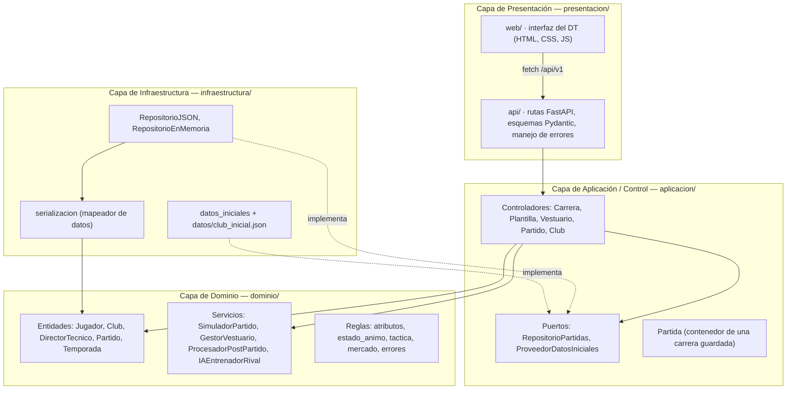
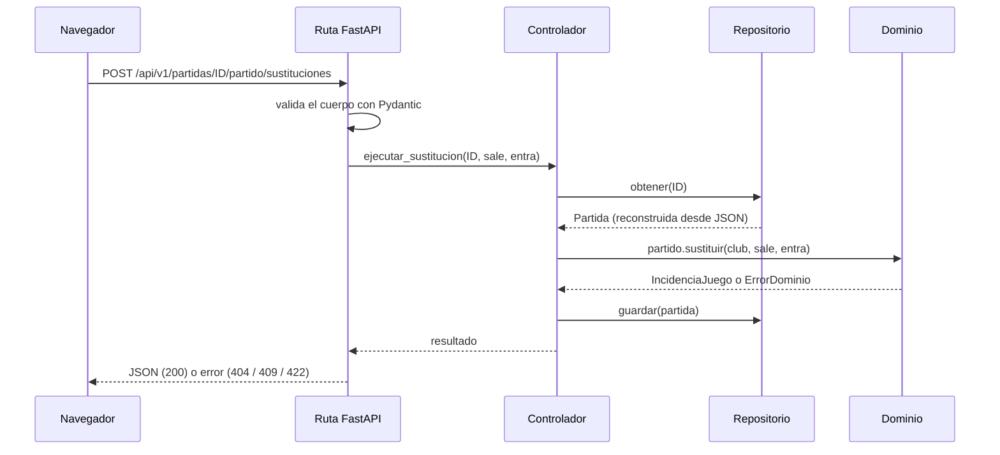

# 04 · Arquitectura

Fuente: sección 9 de la especificación («organización estricta en 4 capas») y la
restricción de la sección 4 («el motor de cálculo de dominio debe ser independiente del
motor gráfico o de la interfaz»).

## Capas



| Capa | Responsabilidad | Puede depender de | No puede depender de |
|---|---|---|---|
| Presentación | Renderizar la interfaz, exponer la API, validar formato de entrada, traducir errores a HTTP. | Aplicación, Dominio (enums y errores) | — |
| Aplicación | Coordinar casos de uso: cargar la partida, delegar en el dominio, guardar. **Sin reglas de negocio.** | Dominio | Presentación, Infraestructura, FastAPI |
| Dominio | Motor de partidos, reglas financieras, comportamiento de jugadores. | Solo la biblioteca estándar | Todas las demás capas y todo framework |
| Infraestructura | Persistir partidas, leer archivos de datos, generar rivales y mercado. | Aplicación (puertos y `Partida`), Dominio | Presentación |

La infraestructura queda «abajo» en la organización, pero sus dependencias apuntan hacia
adentro: la aplicación declara los puertos y la infraestructura los implementa
(inversión de dependencias). La única pieza que conoce a todas las capas es la fábrica
`presentacion/app.py::crear_app`, que las conecta al arrancar.

### Verificación automática

`tests/unitarias/test_arquitectura.py` analiza los `import` de cada archivo y falla si:

- un módulo de `dominio/` importa `fastapi`, `pydantic`, `starlette`, `uvicorn` o sale del
  paquete con `..`;
- un módulo de `aplicacion/` importa la presentación, la infraestructura o un framework web;
- un módulo de `infraestructura/` importa la presentación.

## Flujo de una petición



## Decisiones de diseño

| ID | Decisión | Alternativas | Motivo |
|---|---|---|---|
| **DEC-01** | FastAPI como framework web. | Flask, Django. | Pedido por el proyecto; validación con Pydantic y documentación OpenAPI automática en `/docs`. |
| **DEC-02** | Partidas guardadas como un archivo JSON por partida, con escritura atómica. Repositorio en memoria para pruebas. | SQLite, PostgreSQL. | Sin servidor de base de datos; el formato es legible y versionado (`version_formato`). El puerto permite cambiarlo sin tocar el dominio. |
| **DEC-03** | La máquina de estados implementa las 4 transiciones de la especificación, la de RN-03 (sanción cumplida) y 3 extensiones marcadas: Motivado → Estable (derrota o falta de minutos) y Molesto → Estable (mediación). | Solo las 4 transiciones. | Sin extensiones, Motivado y Molesto serían estados sin salida en una temporada. Las extensiones están separadas en `TRANSICIONES_EXTENSION`. |
| **DEC-04** | Aleatoriedad reproducible: cada acción usa `Random(semilla · 1 000 003 + contador)`. | `random` global. | La misma semilla y las mismas decisiones reproducen la partida: pruebas deterministas y errores reproducibles. |
| **DEC-05** | Interfaz web en HTML, CSS y JavaScript sin dependencias, servida por FastAPI. El DOM se construye con `textContent`, nunca con `innerHTML`. | React, Vue, plantillas Jinja. | Sin paso de compilación; la presentación consume la misma API pública que cualquier otro cliente. Evita inyección de HTML. |
| **DEC-06** | El cliente simula en bloques de 3 minutos cada ~0.65 s. | WebSockets, Server-Sent Events. | Sensación de tiempo real sin conexiones persistentes; el servidor no guarda estado entre peticiones. |
| **DEC-07** | Validación de atributos en dos políticas: rechazar entradas fuera de rango y saturar valores calculados. | Solo rechazar. | RN-01 se cumple sin que un cálculo intermedio rompa la simulación. |

## Estructura de carpetas

```text
src/pro_manager/
├── __init__.py, __main__.py, main.py
├── dominio/
│   ├── atributos.py        RN-01
│   ├── enums.py
│   ├── errores.py          Jerarquía ErrorDominio
│   ├── estado_animo.py     Máquina de estados (RN-03)
│   ├── jugador.py          Information Expert
│   ├── director_tecnico.py
│   ├── club.py             RN-02 y aval de sanciones
│   ├── tactica.py          Alineación y formaciones (HU-01)
│   ├── partido.py          Creator de IncidenciaJuego (CU-01)
│   ├── simulador.py        Motor de partidos (HU-05)
│   ├── ia_rival.py
│   ├── vestuario.py        HU-04
│   ├── post_partido.py
│   ├── temporada.py
│   └── mercado.py          HU-02 y HU-03
├── aplicacion/
│   ├── controladores.py    Patrón Controller
│   ├── partida.py
│   ├── puertos.py
│   └── errores.py
├── infraestructura/
│   ├── repositorios.py
│   ├── serializacion.py
│   ├── datos_iniciales.py
│   ├── config.py
│   └── datos/club_inicial.json
└── presentacion/
    ├── app.py              Fábrica de la aplicación
    ├── api/                rutas, esquemas, mapeo, dependencias, errores
    └── web/                index.html, static/app.js, static/estilos.css
```

## Seguridad

- Los identificadores de partida se validan con una expresión regular antes de formar una
  ruta de archivo (evita *path traversal*); probado en `test_persistencia.py`.
- La interfaz nunca inserta HTML recibido del servidor.
- No hay secretos en el repositorio; la configuración va por variables de entorno.
- La aplicación no tiene autenticación: cualquiera con acceso al servidor puede ver o
  borrar partidas. Es aceptable para uso local o académico; agrega autenticación antes de
  ofrecerla a terceros.
