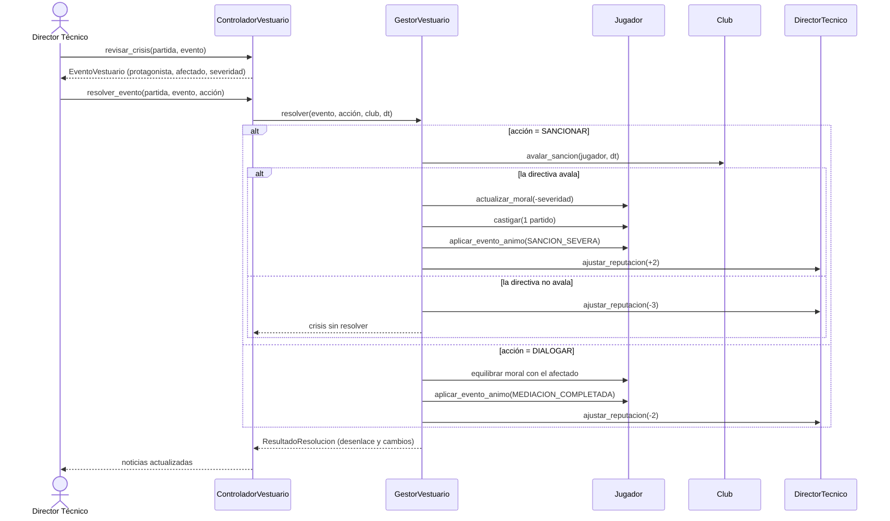
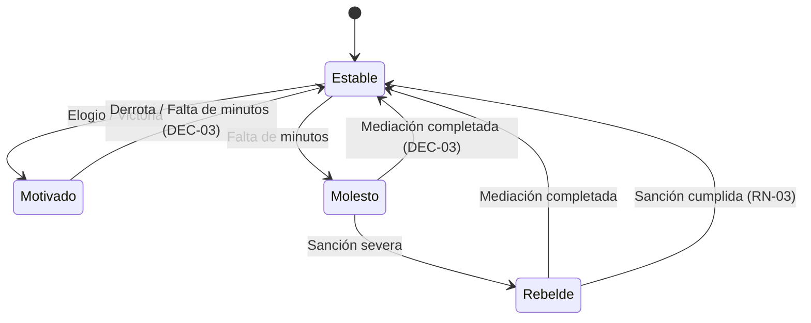
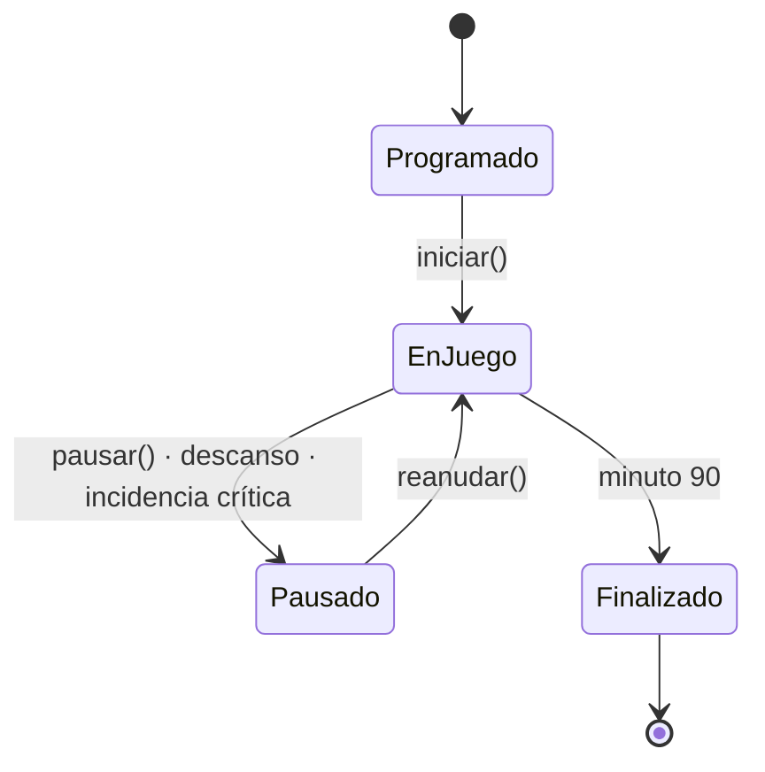

# 05 · Diseño dinámico

Fuente: sección 10 de la especificación.

## Secuencia: gestión de crisis de vestuario

## Máquina de estados del jugador

| Origen | Evento | Destino | Fuente |
|---|---|---|---|
| Estable | Elogio, Victoria | Motivado | Especificación |
| Estable | Falta de minutos | Molesto | Especificación |
| Molesto | Sanción severa | Rebelde | Especificación |
| Rebelde | Mediación completada | Estable | Especificación |
| Rebelde | Sanción cumplida | Estable | RN-03 |
| Motivado | Derrota, Falta de minutos | Estable | Extensión DEC-03 |
| Molesto | Mediación completada | Estable | Extensión DEC-03 |

Cualquier otra combinación deja el estado igual. Ningún evento lleva directamente de
Estable a Rebelde, y nada distinto de mediación o sanción cumplida saca a un jugador de
Rebelde.

### Qué dispara cada evento en el juego

| Evento | Disparador |
|---|---|
| Elogio | El DT elogia en público a un jugador (una vez por jornada). |
| Victoria / Derrota | Final del partido, para quienes participaron. |
| Falta de minutos | Un jugador del grupo de 15 con mayor calidad suma 2 partidos seguidos sin jugar estando disponible. |
| Sanción severa | El DT sanciona en una crisis de vestuario con aval de la directiva. |
| Sanción cumplida | Termina el partido en el que el jugador cumplía su sanción interna. |
| Mediación completada | El DT elige dialogar en una crisis de vestuario. |

## Máquina de estados del partido

## Modelo matemático de la simulación

Cada minuto, para cada equipo:

1. **Fuerza por línea:** promedio del rendimiento actual de porteros, defensas,
   mediocampistas y delanteros en el campo. Sin portero, la línea vale 25; una línea
   vacía vale 35.
2. **Ataque** = 0.55 · delanteros + 0.35 · medios + 0.10 · defensas.
   **Defensa** = 0.30 · portero + 0.45 · defensas + 0.25 · medios.
3. **Forma del equipo:** ataque × (1 + 0.04 · (n_del − 2) + 0.02 · (n_med − 4));
   defensa × (1 + 0.04 · (n_def − 4) + 0.02 · (n_med − 4)).
4. **Mentalidad:** defensiva (×0.85 ataque, ×1.15 defensa), equilibrada (×1, ×1),
   ofensiva (×1.15 ataque, ×0.88 defensa). La ofensiva también duplica la fatiga.
5. **Inferioridad numérica:** ambos valores × (jugadores en campo / 11).
6. **Probabilidad de gol** = 0.0135 · (ataque / defensa rival)^1.6, × 1.08 si es local,
   acotada a [0.002, 0.045]. El goleador se sortea con peso por posición
   (DEL 6, MED 3, DEF 1, POR 0) multiplicado por su rendimiento.
7. **Disciplina:** 1.8 % de amarilla por minuto (los temperamentales pesan el doble);
   0.07 % de roja directa. Dos amarillas = expulsión. Nunca se baja de 7 en el campo.
8. **Lesión:** 0.35 % por minuto; la baja dura de 1 a 3 partidos.
9. **Fatiga:** cada 5 minutos, −1 de físico (−2 con mentalidad ofensiva).
10. **IA rival:** cambia a sus lesionados de inmediato, a su jugador más cansado en los
    minutos 60, 70 y 80, y ajusta su mentalidad en los minutos 60 y 75 según el marcador.

Con estos valores, dos equipos parejos promedian unos 2.5 goles por partido
(`test_promedio_de_goles_realista` exige entre 1.5 y 4).

## Consecuencias al terminar un partido

`ProcesadorPostPartido` aplica, en este orden:

1. **DT y club:** experiencia +1; reputación del DT +3 / 0 / −3 (doble en el partido
   decisivo); reputación del club ±1.
2. **Finanzas:** taquilla de $150,000 si juega en casa; premio de $250,000 por victoria o
   $80,000 por empate.
3. **Jugadores:** moral ±5 y evento Victoria/Derrota para quienes jugaron; falta de
   minutos para quienes se quedaron fuera (RN-10); +25 de físico para todos.
4. **Bajas:** descuenta lesiones, suspensiones y sanciones internas; una sanción cumplida
   devuelve al Rebelde a Estable; una expulsión suspende un partido.
5. **Narrativa:** `GestorVestuario.generar_evento` puede crear una nueva crisis
   (indisciplina de un Rebelde, queja de un Molesto, conflicto o rumor).
